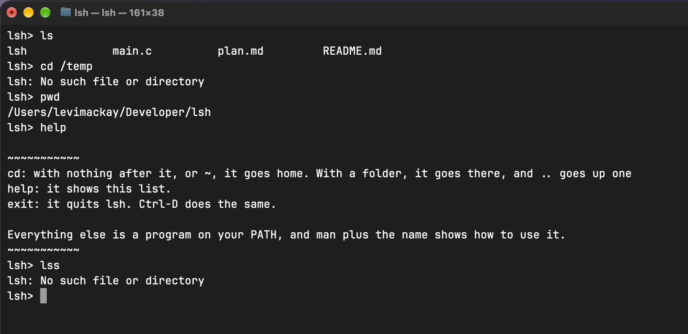

# LSH 
In order to understand how basic systems work, I decided to program my own shell terminal in C. 

## Example

## What it can do
Right now, there are a handful of commands that it can run. Just about everything that you can run in your normal terminal can be run here.

- cd
- ls
- help
- etc

Commands of any length work. For the longest time I couldn't figure out how to have a line longer than 1024 characters. 

## Build and run
Before anything, you need to make sure that you have a C compiler on your computer. (Right now this is only working on MacOS, so keep that in mind.)

1. git clone https://github.com/levimackay/lsh.git
2. cd lsh
3. cc -Wall -Wextra -o lsh main.c
4. ./lsh

## How it works

## Limits

## What's next?

